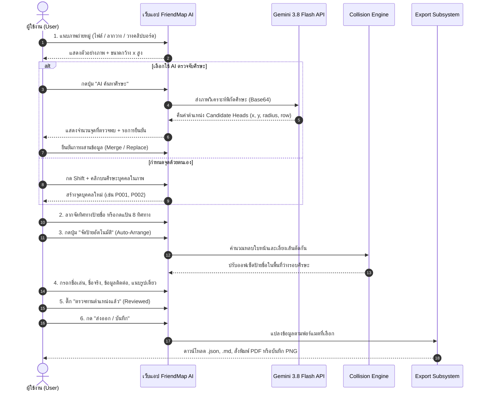
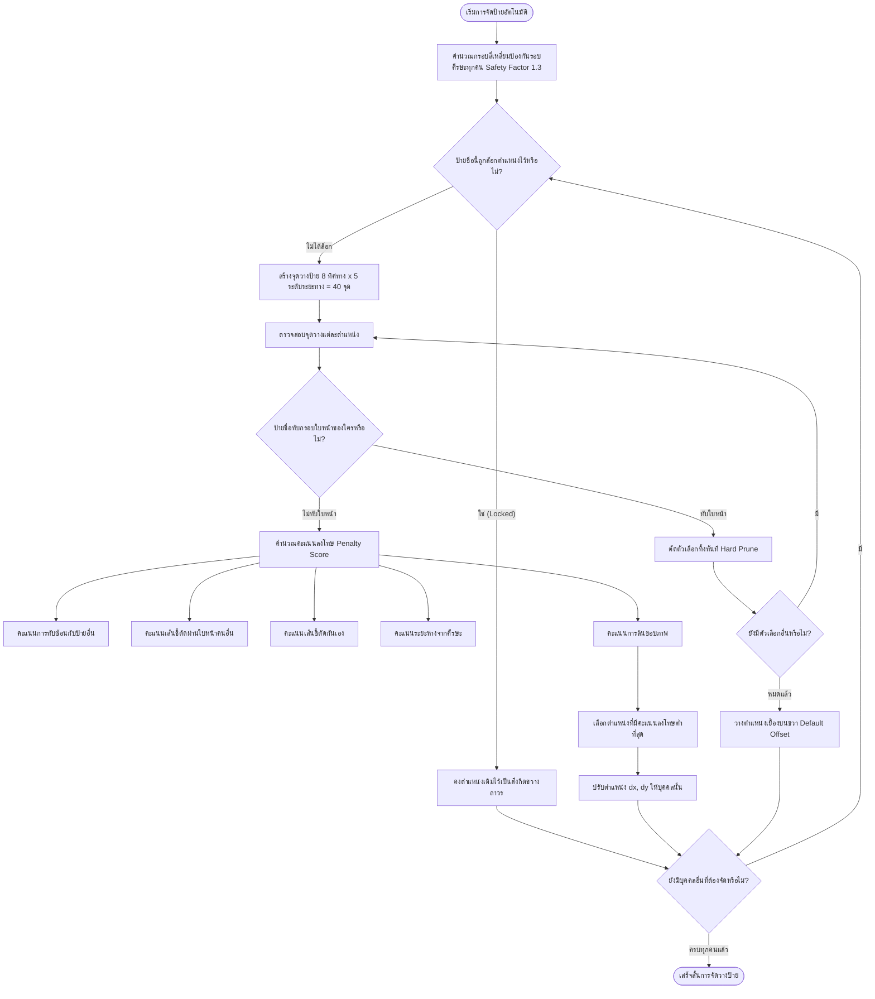

# คู่มือการใช้งานระบบ FriendMap AI (Photo People Mapper & Interactive Balloons)

> **FriendMap AI** คือ Web Application สำหรับนำภาพถ่ายหมู่ (Group Photography) มาแปลงเป็น **"แผนที่บุคคลแบบโต้ตอบ (Interactive People Map)"** โดยใช้ระบบป้ายชื่อบอลลูนการ์ตูนและเส้นชี้ศีรษะ (Leader Lines) แยกชั้นข้อมูลออกจากภาพถ่ายจริง 100% (Non-Destructive) ช่วยให้จำชื่อเพื่อน ค้นหาบุคคล บันทึกประวัติ และส่งออกเป็นเอกสาร JSON, Markdown, และรายงาน PDF ขนาด A4 ได้ทันที

---

## 📑 สารบัญ (Table of Contents)

1. [แนวคิดหลักและสถาปัตยกรรมระบบ (Core Concept)](#1-แนวคิดหลักและสถาปัตยกรรมระบบ)
2. [แผนผังกระบวนการทำงาน (System Workflows & Mermaid Diagrams)](#2-แผนผังกระบวนการทำงาน-mermaid-diagrams)
3. [คู่มือการใช้งานทีละขั้นตอนสำหรับผู้เริ่มต้น (Step-by-Step Guide)](#3-คู่มือการใช้งานทีละขั้นตอนสำหรับผู้เริ่มต้น)
   - [ขั้นตอนที่ 1: การแนบภาพถ่ายหมู่เข้าสู่ระบบ](#ขั้นตอนที่-1-การแนบภาพถ่ายหมู่เข้าสู่ระบบ)
   - [ขั้นตอนที่ 2: การระบุตำแหน่งศีรษะบุคคล (AI หรือ กำหนดเอง)](#ขั้นตอนที่-2-การระบุตำแหน่งศีรษะบุคคล)
   - [ขั้นตอนที่ 3: การปรับทิศทางป้ายชื่อและการล็อกตำแหน่ง](#ขั้นตอนที่-3-การปรับทิศทางป้ายชื่อและการล็อกตำแหน่ง)
   - [ขั้นตอนที่ 4: การจัดป้ายอัตโนมัติหลบใบหน้า (Collision Avoidance)](#ขั้นตอนที่-4-การจัดป้ายอัตโนมัติหลบใบหน้า)
   - [ขั้นตอนที่ 5: การกรอกข้อมูลบุคคลและแนบภาพถ่ายเดี่ยว](#ขั้นตอนที่-5-การกรอกข้อมูลบุคคลและแนบภาพถ่ายเดี่ยว)
   - [ขั้นตอนที่ 6: การค้นหาในสมุดรายชื่อ (Directory Drawer)](#ขั้นตอนที่-6-การค้นหาในสมุดรายชื่อ)
   - [ขั้นตอนที่ 7: การส่งออกไฟล์ JSON, Markdown, และสั่งพิมพ์ PDF](#ขั้นตอนที่-7-การส่งออกไฟล์-json-markdown-และสั่งพิมพ์-pdf)
   - [ขั้นตอนที่ 8: การล้างข้อมูลเริ่มต้นใหม่ (Clear & Reset)](#ขั้นตอนที่-8-การล้างข้อมูลเริ่มต้นใหม่)
4. [โหมดการทำงาน 2 รูปแบบ: Editor vs Viewer](#4-โหมดการทำงาน-editor-vs-viewer)
5. [อภิธานศัพท์เทคนิคภายในระบบ (Technical Glossary)](#5-อภิธานศัพท์เทคนิคภายในระบบ)
6. [โครงสร้างข้อมูล Metadata JSON ของภาพถ่าย](#6-โครงสร้างข้อมูล-metadata-json-ของภาพถ่าย)
7. [ฟีเจอร์ขั้นสูงและปุ่มลัดแป้นพิมพ์ (Power Features & Shortcuts)](#7-ฟีเจอร์ขั้นสูงและปุ่มลัดแป้นพิมพ์)

---

## 1. แนวคิดหลักและสถาปัตยกรรมระบบ

FriendMap AI ยึดหลักการสำคัญ 3 ประการ:
1. **ภาพถ่ายต้นฉบับไม่ถูกแตะต้อง (Immutable Original):** ไม่มีการเขียนข้อความทับลงบนพิกเซลของภาพถ่ายต้นฉบับ
2. **ระบบพิกัดสัดส่วนสัมพัทธ์ (Normalized Coordinates 0.0 – 1.0):** ทุกตำแหน่งศีรษะ $(x, y)$ และออฟเซ็ตป้าย $(dx, dy)$ ถูกคำนวณเป็นสัดส่วนต่อความกว้างและความสูงของภาพ ทำให้เมื่อย่อ-ขยายหน้าจอ ซูมภาพ หรือเปิดบนมือถือ จุดชี้จะไม่เลื่อนหลุดจากศีรษะบุคคลเดิม
3. **การควบคุมโดยมนุษย์ร่วมกับ AI (Human-in-the-Loop):** AI ทำหน้าที่เป็นผู้ช่วยค้นหาตำแหน่งศีรษะเท่านั้น โดยไม่เดาชื่อบุคคลอัตโนมัติ เพื่อป้องกันความผิดพลาดและเคารพสิทธิความเป็นส่วนตัว (PDPA)

```mermaid
graph TD
    subgraph Layer1 [Layer 1: ภาพต้นฉบับ (Immutable Photo)]
        IMG[ไฟล์ภาพถ่ายหมู่ดั้งเดิม JPG/PNG]
    end

    subgraph Layer2 [Layer 2: พิกัดสัมพัทธ์ (Normalized Engine)]
        NORM[พิกัด x, y, dx, dy ในช่วง 0.0 ถึง 1.0]
    end

    subgraph Layer3 [Layer 3: ชั้นแสดงผลแบบโต้ตอบ (Interactive Overlay)]
        SVG[SVG Leader Lines เส้นชี้ศีรษะ]
        BALLOON[ป้ายชื่อบอลลูนการ์ตูน ดึงลากได้ 360 องศา]
        HALO[กรอบพื้นที่ปลอดภัยรอบใบหน้า Face Halos]
    end

    subgraph Layer4 [Layer 4: ทะเบียนประวัติและส่งออก (Registry & Export)]
        REG[สมุดรายชื่อ + รูปเดี่ยว + ข้อมูลติดต่อ]
        OUT_JSON[ไฟล์ Photo Metadata JSON]
        OUT_MD[รายงาน Markdown .md]
        OUT_PDF[รายงานการพิมพ์ PDF A4]
        OUT_PNG[ภาพเรนเดอร์พร้อมป้าย PNG]
    end

    IMG --> NORM
    NORM --> SVG
    NORM --> BALLOON
    BALLOON --> REG
    REG --> OUT_JSON
    REG --> OUT_MD
    REG --> OUT_PDF
    REG --> OUT_PNG
```

---

## 2. แผนผังกระบวนการทำงาน (Mermaid Diagrams)

### 2.1 แผนภาพวงจรการทำงานของผู้ใช้ (User Journey Workflow)



### 2.2 อัลกอริทึมจัดป้ายชื่อหลบใบหน้า (Collision-Free Algorithm Flow)



---

## 3. คู่มือการใช้งานทีละขั้นตอนสำหรับผู้เริ่มต้น

### ขั้นตอนที่ 1: การแนบภาพถ่ายหมู่เข้าสู่ระบบ
มี 4 ช่องทางให้เลือกตามความสะดวก:
1. **คลิกปุ่ม "แนบภาพถ่าย"** บนแถบเมนูด้านบน เพื่อเปิดหน้าต่างเลือกไฟล์
2. **ลากไฟล์ภาพมาปล่อย (Drag & Drop)** ได้ทุกที่บนหน้าจอ จะมีกรอบแอนิเมชันสีทองต้อนรับ
3. **กดคีย์ลัด `Ctrl+V` (หรือ `Cmd+V`)** เพื่อวางภาพที่ Copy มาจากคลิปบอร์ด
4. **คลิก "ถ่ายภาพ"** สำหรับใช้งานบนสมาร์ตโฟนหรืออุปกรณ์ที่มีกล้อง

> **ตัวเลือกหลังแนบภาพ:**
> * *ให้ AI วิเคราะห์ค้นหาศีรษะอัตโนมัติทันที (แนะนำ):* ระบบจะสแกนหาตำแหน่งบุคคลและสร้างป้ายชื่อตั้งต้นให้ทันที
> * *คงตำแหน่งจุดและรายชื่อเดิมไว้:* ใช้สำหรับกรณีอัปโหลดภาพมุมเดิมแต่ความละเอียดสูงขึ้น
> * *เริ่มภาพใหม่ว่างเปล่า:* ล้างรายชื่อเดิมออกทั้งหมดเพื่อเริ่มมาร์กจุดใหม่ด้วยตนเอง

---

### ขั้นตอนที่ 2: การระบุตำแหน่งศีรษะบุคคล
* **วิธีที่ 1 (ใช้ AI ช่วย):** คลิกปุ่ม **"AI ค้นหาศีรษะ"** (ไอคอนดาววิบวับ) ด้านบน ระบบจะส่งภาพไปวิเคราะห์ด้วย Gemini 3.8 Flash เมื่อผลลัพธ์ปรากฏ ให้คลิก **"แทนที่ด้วยผลตรวจจับ"** หรือ **"ผสานกับข้อมูลเดิม"**
* **วิธีที่ 2 (กำหนดจุดเอง):** กดปุ่ม **`Shift` บนคีย์บอร์ดค้างไว้ แล้วคลิกเมาส์ซ้ายลงบนศีรษะของบุคคลในภาพ** (หรือกดปุ่ม **"เพิ่มจุด"** บนแถบควบคุมซ้ายบน แล้วคลิกภาพ) ระบบจะสร้างรหัสบุคคลใหม่ เช่น `P001`, `P002` ทันที
* **การย้ายตำแหน่งศีรษะ:** คลิกที่จุดสีส้มค้างไว้แล้วลาก (Drag) ไปยังตำแหน่งกึ่งกลางศีรษะที่ถูกต้อง

---

### ขั้นตอนที่ 3: การปรับทิศทางป้ายชื่อและการล็อกตำแหน่ง
* **ลากป้ายด้วยเมาส์:** คลิกที่ป้ายชื่อบอลลูนค้างไว้ แล้วลากหมุนรอบศีรษะได้อย่างอิสระ เส้นชี้จะปรับองศาตามอัตโนมัติ
* **ใช้แป้น 8 ทิศทาง (Compass Pad):** ในแถบขวามือ คลิกเลือกลูกศรทิศทางที่ต้องการ (NW, N, NE, W, E, SW, S, SE)
* **ปรับความยาวเส้นชี้:** เลื่อนแถบสไลเดอร์ "ระยะห่างเส้นชี้" ในแถบขวามือ
* **การล็อกตำแหน่งป้าย (Lock Position):** หากจัดตำแหน่งป้ายชื่อมุมนี้สวยงามแล้ว ให้คลิกปุ่ม **"ล็อกตำแหน่ง"** (ไอคอนแม่กุญแจ) เพื่อป้องกันไม่ให้อัลกอริทึมอัตโนมัติมาเลื่อนป้ายนี้อีก

---

### ขั้นตอนที่ 4: การจัดป้ายอัตโนมัติหลบใบหน้า (Collision Avoidance)
เมื่อมีบุคคลจำนวนมาก (เช่น 30–50 คน) ป้ายชื่ออาจบดบังใบหน้าบุคคลในแถวถัดไป:
* คลิกปุ่ม **"จัดป้ายอัตโนมัติ"** บนแถบเมนูด้านบน
* ระบบจะคำนวณ 40 พิกัดรอบศีรษะของทุกคน หลีกเลี่ยงเขตใบหน้าของเพื่อน และจัดวางป้ายในพื้นที่ว่างที่สวยงามที่สุดทันที

---

### ขั้นตอนที่ 5: การกรอกข้อมูลบุคคลและแนบภาพถ่ายเดี่ยว
คลิกเลือกบุคคลที่ต้องการแก้ไข จากนั้นกรอกข้อมูลในแถบด้านขวา:
1. **ชื่อเล่น:** เช่น `พี่หนึ่ง`, `กอล์ฟ`, `เปิ้ล` (ข้อความนี้จะแสดงเด่นบนป้ายบอลลูน)
2. **ชื่อ-นามสกุลจริง:** เช่น `ดร. อนุสรณ์ ชัยวัฒน์`
3. **กลุ่ม / ตำแหน่งแถว:** เช่น `แถวยืนหลัง`, `แถวกลาง`, `แถวนั่งหน้า`, `คณะทำงาน`
4. **แนบรูปบุคคล (Portrait Avatar):** คลิกปุ่ม **"แนบรูป"** เพื่อใส่ภาพถ่ายเดี่ยวหรือรูปใบหน้าของเพื่อนคนนั้น
5. **ข้อมูลติดต่อ:** โทรศัพท์, อีเมล, LINE ID, และบันทึกประวัติเพิ่มเติม
6. **ทำเครื่องหมายสถานะ:** ติ๊กช่อง **"ตรวจทานตำแหน่งแล้ว"** แถบสถานะด้านบนจะอัปเดตสถิติจำนวนคนที่ตรวจแล้วทันที

---

### ขั้นตอนที่ 6: การค้นหาในสมุดรายชื่อ (Directory Drawer)
* คลิกปุ่ม **"รายชื่อ (31)"** มุมซ้ายบน เพื่อเปิดลิ้นชักสมุดทะเบียนรายชื่อ
* พิมพ์ค้นหาตามชื่อเล่น ชื่อจริง รหัส หรือลักษณะเสื้อผ้า (เช่น `แว่นตา`, `ช่างภาพ`, `สูทน้ำเงิน`)
* กรองตามสถานะ: `ทั้งหมด`, `รอตรวจ`, หรือ `ตรวจแล้ว`
* **คลิกที่รายชื่อใดๆ:** มุมมองภาพจะเลื่อนและไฮไลต์บุคคลนั้นบนภาพถ่ายทันที

---

### ขั้นตอนที่ 7: การส่งออกไฟล์ JSON, Markdown, และสั่งพิมพ์ PDF
คลิกปุ่มสีทอง **"ส่งออก / บันทึก"** ทางด้านขวาบน:

| ฟอร์แมตที่ส่งออก | รายละเอียดและการนำไปใช้งาน | ชื่อไฟล์ตัวอย่าง |
|---|---|---|
| **ไฟล์ JSON (.json)** | บันทึกพิกัดศีรษะ สถิติภาพ และข้อมูลประวัติครบถ้วน สำหรับนำเข้ากลับมาเปิดทำงานต่อ | `32980304_10214774071859417_974758122205741056_n.json` |
| **รายงาน Markdown (.md)** | เอกสารสรุปตารางรายชื่อบุคคลและประวัติรายคน สำหรับนำไปวางในระบบจดบันทึก เช่น Obsidian หรือ GitHub | `32980304_10214774071859417_974758122205741056_n.md` |
| **พิมพ์และบันทึก PDF (.pdf)** | เอกสารรายงานทางการขนาด A4 พร้อมสถิติ KPI, ตารางรายชื่อ, และสถานะตรวจทาน สั่งพิมพ์หรือกด Save as PDF ได้ทันที | `32980304_10214774071859417_974758122205741056_n.pdf` |
| **ภาพพร้อมป้าย (PNG)** | เรนเดอร์ภาพถ่ายจริงพร้อมป้ายชื่อและเส้นชี้ลงไฟล์รูปภาพความละเอียดสูงสำหรับแชร์ลง LINE หรือ Facebook | `32980304_10214774071859417_974758122205741056_n-annotated.png` |

> 🔒 **โหมดปกป้องความเป็นส่วนตัว (Private-by-default):** ติ๊กเปิดตัวเลือกนี้เพื่อตัดเบอร์โทรศัพท์และ LINE ID ออกจากไฟล์ส่งออกทุกชนิดตามมาตรฐาน PDPA

---

### ขั้นตอนที่ 8: การล้างข้อมูลเริ่มต้นใหม่ (Clear & Reset)
หากต้องการเริ่มงานใหม่ ให้คลิกปุ่ม **"ล้างข้อมูล"** บนแถบเมนู:
* **ล้างเฉพาะจุดบุคคล:** ลบจุดบุคคลทั้งหมดออก แต่ยังคงภาพถ่ายปัจจุบันไว้ เพื่อให้หน้าจอดูดลีนและพร้อมคลิกจุดแรกได้ด้วยตนเอง
* **ล้างภาพและจุดทั้งหมด:** ล้างทั้งภาพและจุดออก กลายเป็นหน้าจอกระดานเปล่า 100%
* **โหลดตัวอย่าง 31 คน:** เมื่อกระดานว่าง สามารถคลิกปุ่มนี้เพื่อเรียกชุดข้อมูลตัวอย่าง 31 คนกลับมาได้ตลอดเวลา

---

## 4. โหมดการทำงาน: Editor vs Viewer

สลับโหมดได้จากปุ่มเลือกตรงกลางแถบเมนูด้านบน:

```
[ โหมดจัดวาง (Editor) ]  |  [ โหมดนำเสนอ (Viewer) ]
```

* **โหมดจัดวาง (Editor Mode):**
  * เหมาะสำหรับ: ผู้จัดการภาพ, แอดมินรุ่น, ผู้ตรวจทานข้อมูล
  * ความสามารถ: ลากป้ายชื่อ, เลื่อนจุดศีรษะ, เพิ่ม/ลบบุคคล, กรอกข้อมูลประวัติ, เรียกใช้ AI, จัดป้ายอัตโนมัติ
* **โหมดนำเสนอ (Viewer Mode):**
  * เหมาะสำหรับ: บุคคลทั่วไปเปิดดูภาพเพื่อระลึกความหลัง
  * ความสามารถ: ล็อกพิกัดป้องกันป้ายเคลื่อน, คลิกป้ายบอลลูนเพื่อเปิดดูโปรไฟล์อย่างสวยงาม, ค้นหารายชื่อ, ป้องกันการแก้ไขโดยไม่ได้ตั้งใจ

---

## 5. อภิธานศัพท์เทคนิคภายในระบบ (Technical Glossary)

1. **Normalized Coordinates (พิกัดสัดส่วนสัมพัทธ์):**  
   ค่าตัวเลขระหว่าง $0.0$ ถึง $1.0$ แทนตำแหน่งเทียบกับขนาดภาพทั้งหมด เช่น $x = 0.5, y = 0.5$ คือจุดกึ่งกลางภาพพอดี ช่วยให้ภาพคงตำแหน่งถูกต้องแม้เปิดบนหน้าจอขนาดต่างกัน
2. **Leader Line (เส้นชี้ศีรษะ):**  
   เส้นเวกเตอร์ที่โยงระหว่างจุดกึ่งกลางศีรษะของบุคคล (Head Anchor) ไปยังป้ายชื่อบอลลูน (Label Attachment)
3. **Face Exclusion Zone / Safety Halo (เขตปลอดภัยรอบใบหน้า):**  
   พื้นที่สี่เหลี่ยมสมมติรอบศีรษะบุคคลที่คำนวณขยายออก $130\%$ ซึ่งอัลกอริทึมจัดป้ายอัตโนมัติจะถือเป็น "พื้นที่ต้องห้าม (No-fly Zone)" ที่ห้ามให้ป้ายชื่อใดๆ มาทับ
4. **Collision Avoidance (การเลี่ยงการชนกัน):**  
   การคำนวณทางเรขาคณิตเพื่อป้องกัน 3 สิ่ง: (1) ป้ายชื่อทับใบหน้า, (2) ป้ายชื่อทับกันเอง, และ (3) เส้นชี้ตัดผ่านใบหน้าผู้อื่น
5. **Review Queue (คิวรอการตรวจทาน):**  
   สถานะสำหรับบุคคลที่เพิ่งถูกตรวจจับด้วย AI หรือเพิ่งถูกสร้างขึ้นมาใหม่ (`reviewed: false`) เพื่อรอให้มนุษย์เข้ามาตรวจสอบและยืนยันความถูกต้อง
6. **Immutable Photo Layer (ชั้นภาพถ่ายต้นฉบับคงสภาพ):**  
   แนวคิดการแยกไฟล์ภาพถ่ายต้นฉบับออกจากข้อความคำอธิบาย โดยไม่แปลงพิกเซลเดิม เพื่อรักษาคุณค่าของภาพถ่ายไว้สมบูรณ์
7. **Photo Metadata JSON:**  
   รูปแบบไฟล์ JSON มาตรฐาน (`friendmap_photo_metadata`) ที่รวบรวมทั้งข้อมูลภาพถ่าย (ขนาด, วันที่, ข้อมูลกล้อง), การตั้งค่าธีม, และพิกัดรายชื่อทุกคนไว้ในไฟล์เดียว
8. **Private-by-default:**  
   มาตรฐานความปลอดภัยที่ระบบจะซ่อนข้อมูลส่วนบุคคลที่อ่อนไหว (เบอร์โทรศัพท์, อีเมล, LINE ID) เป็นค่าเริ่มต้น และเปิดเผยเฉพาะเมื่อได้รับอนุญาต
9. **OneVault / OneManOS Integration:**  
   สถาปัตยกรรมที่ใช้รหัสบุคคล (`id`) เดียวกันอ้างอิงข้ามหลายภาพถ่าย เพื่อสร้างเป็นคลังทะเบียนประวัติความสัมพันธ์ระยะยาว

---

## 6. โครงสร้างข้อมูล Metadata JSON ของภาพถ่าย

ตัวอย่างไฟล์ `32980304_10214774071859417_974758122205741056_n.json`:

```json
{
  "version": "1.0.0",
  "exportType": "friendmap_photo_metadata",
  "exportedAt": "2026-10-12T00:00:00.000Z",
  "photoMetadata": {
    "id": "32980304_10214774071859417_974758122205741056_n",
    "fileName": "32980304_10214774071859417_974758122205741056_n.jpg",
    "title": "32980304_10214774071859417_974758122205741056_n",
    "width": 1536,
    "height": 959,
    "aspectRatio": 1.60167,
    "depthLayers": 3
  },
  "statistics": {
    "totalPeople": 31,
    "reviewedCount": 16,
    "unreviewedCount": 15,
    "rowsCount": 3
  },
  "people": [
    {
      "id": "P001",
      "name": "กานต์สินี สุวรรณรัตน์",
      "nickname": "กานต์",
      "groupTag": "แถวยืนหลัง",
      "contact": {
        "phone": "081-423-9901",
        "email": "karnsinee.s@example.com",
        "lineId": "karn_suwan"
      },
      "notes": "ยืนริมซ้ายสุด เสื้อโปโลเหลือง-เทา",
      "head": {
        "x": 0.038,
        "y": 0.285,
        "radius": 0.026
      },
      "label": {
        "dx": -0.015,
        "dy": -0.11,
        "locked": false,
        "visible": true
      },
      "reviewed": true,
      "depthRow": "back_standing",
      "visualHint": "หญิง ยืนซ้ายสุด เสื้อโปโลเทาขลิบเหลือง"
    }
  ]
}
```

---

## 7. ฟีเจอร์ขั้นสูงและปุ่มลัดแป้นพิมพ์ (Power Features & Shortcuts)

เพื่อเพิ่มประสิทธิภาพในการทำงานกับภาพถ่ายขนาดใหญ่ที่มีบุคคลจำนวนมาก ระบบได้เพิ่ม 5 ขีดความสามารถขั้นสูง:

### 1. ระบบภาพครอปใบหน้าอัตโนมัติ (Dynamic Face Cropping)
- นำพิกัดศีรษะ `head: { x, y, radius }` มาคำนวณและวาดครอปใบหน้าเป็นวงกลมบน HTML5 Canvas โดยอัตโนมัติ
- ปรากฏใน **ลิ้นชักสมุดรายชื่อ (Directory Drawer)** และ **หน้าต่างข้อมูลบุคคล (Inspector Panel)**
- ช่วยให้ผู้ใช้ทราบว่าแต่ละหมายเลขคือใครได้ทันทีโดยไม่ต้องคลิกเปิดภาพใหญ่

### 2. ระบบนำเข้ารายชื่อแบบกลุ่ม (Batch Roster Import)
- รองรับการคัดลอกจาก **Excel, Google Sheets หรือแชท LINE** แล้ววางในครั้งเดียว
- รองรับข้อมูลแบบคั่นด้วยแท็บ (`Tab`), จุลภาค (`,`), หรือรายการตัวเลข `1. สมชาย (บอย)`
- มี 3 ยุทธวิธีการนำเข้า:
  1. **จับคู่กับมาร์กเกอร์เดิม:** นำรายชื่อไปใส่ในจุดที่มีอยู่ตามลำดับโดยคงพิกัดเดิมไว้ 100%
  2. **แทนที่รายชื่อทั้งหมด:** เคลียร์รายชื่อเก่าแล้วสร้างรายการใหม่
  3. **เพิ่มต่อท้าย:** สร้างจุดมาร์กเกอร์บุคคลใหม่เพิ่มจากที่มีอยู่เดิม
- มีตารางตรวจสอบความถูกต้อง (Live Table Preview) ก่อนกดยืนยัน

### 3. ระบบบันทึกเสียงความทรงจำ (Voice Memo Greeting)
- สามารถกดปุ่ม **"อัดเสียงสั้น"** บันทึกเสียงทักทายหรือความทรงจำสูงสุด 30 วินาที ผ่าน Web Audio API (`MediaRecorder`)
- หรือเลือกอัปโหลดไฟล์เสียง `.mp3`, `.wav`, `.m4a` เข้าสู่ระบบ
- ไฟล์เสียงจะถูกแปลงเป็น Base64 ฝังรวมอยู่ในไฟล์ Metadata JSON ทำให้เมื่อส่งออกหรือโหลดกลับคืนมายังคงสามารถกดฟังเสียงได้ทุกเมื่อ

### 4. ระบบบันทึกอัตโนมัติและกู้คืนฉบับร่าง (Auto-Save & Local Draft Recovery)
- ระบบทำการ Auto-save ทุกการเคลื่อนไหวลงในเบราว์เซอร์ (`localStorage`) อัตโนมัติ (Debounced 600ms)
- มีไฟสถานะ **"ออโต้เซฟ 14:30"** แสดงเวลาการบันทึกอย่างชัดเจนบนแถบเมนูด้านบน
- หากเกิดเหตุการณ์ไฟฟ้าดับหรือเผลอปิดแท็บเบราว์เซอร์ เมื่อเปิดกลับมาระบบจะกู้คืนฉบับร่างล่าสุดให้ทันที

### 5. ตารางคีย์ลัดแป้นพิมพ์ (Keyboard Shortcuts Cheat Sheet)

| ปุ่มลัด | ฟังก์ชันการทำงาน |
|---|---|
| `J` หรือ `↓` | เลื่อนไปยังบุคคลถัดไป (Next Person) |
| `K` หรือ `↑` | เลื่อนไปยังบุคคลก่อนหน้า (Previous Person) |
| `Space` | สลับเปิด/ปิดการแสดงบอลลูนป้ายชื่อทั้งหมด |
| `A` | สั่งจัดระเบียบป้ายอัตโนมัติไม่ให้บังใบหน้า (Auto-Arrange) |
| `L` | ล็อก / ปลดล็อกตำแหน่งป้ายของคนที่กำลังเลือก |
| `R` | สลับสถานะ: ตรวจแล้ว ↔ รอตรวจ (Reviewed Toggle) |
| `E` / `V` | สลับระหว่างโหมดแก้ไข (Editor) และโหมดนำเสนอ (Viewer) |
| `?` | เปิดหน้าต่างคีย์ลัดและฟีเจอร์ขั้นสูง |
| `Esc` | ยกเลิกการเลือกบุคคล / ปิดกล่องโต้ตอบทุกชนิด |
| `Ctrl + V` | วางภาพจากคลิปบอร์ดเพื่อเริ่มงานใหม่ทันที |

---
*จัดทำโดยทีมพัฒนาระบบ FriendMap AI — Photo People Mapper & Interactive Balloons*
