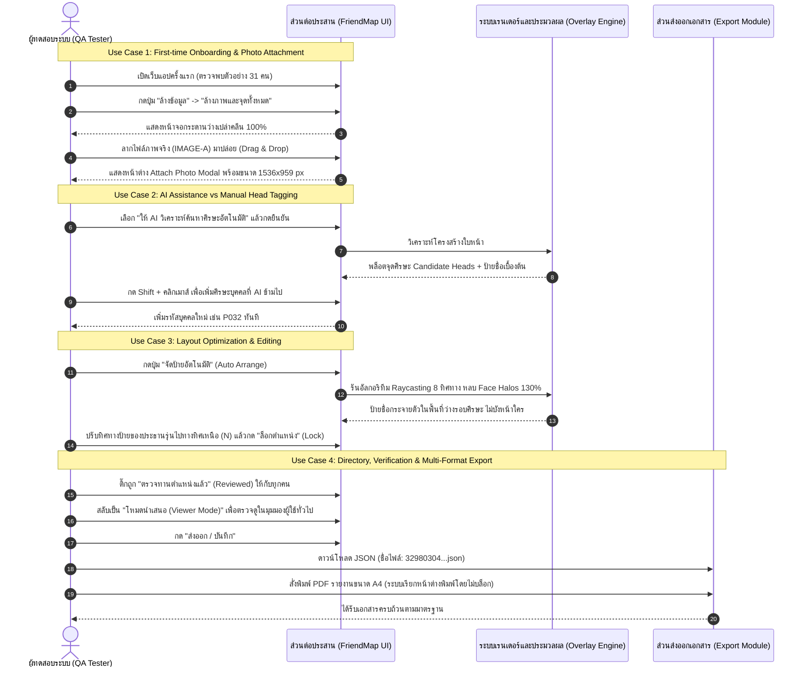

# FriendMap AI — Comprehensive Software Test Specification (TestSpec.md)
**Photo People Mapper & Interactive Name Balloon System — Version 1.0 / 2.0 Baseline**  
*Document Version: 1.0.0 (Master Quality Assurance & Test Specification)*  
*System Reference: FriendMap AI (`designspec.md`, `README.md`)*  
*Target Image Reference: `32980304_10214774071859417_974758122205741056_n.jpg` (1536 × 959 px)*  

---

## 📑 สารบัญ (Table of Contents)

1. [บทนำและวัตถุประสงค์การทดสอบ (Introduction & Objectives)](#1-บทนำและวัตถุประสงค์การทดสอบ)
2. [ขอบเขตและกลยุทธ์การทดสอบ (Scope & Test Strategy)](#2-ขอบเขตและกลยุทธ์การทดสอบ)
3. [สภาพแวดล้อมและสิ่งที่ต้องเตรียมก่อนการทดสอบ (Test Environment & Prerequisites)](#3-สภาพแวดล้อมและสิ่งที่ต้องเตรียมก่อนการทดสอบ)
4. [การจัดเตรียมชุดข้อมูลทดสอบ (Test Data Preparation & Mock Payloads)](#4-การจัดเตรียมชุดข้อมูลทดสอบ)
5. [เมทริกซ์กรณีการใช้งานหลัก (End-to-End Use Case Scenarios)](#5-เมทริกซ์กรณีการใช้งานหลัก)
6. [ชุดกรณีทดสอบระดับฟังก์ชันอย่างละเอียด (Detailed Functional Test Cases)](#6-ชุดกรณีทดสอบระดับฟังก์ชันอย่างละเอียด)
   - [Suite 1: Photo Ingestion & Attachment (TC-ING-001 ถึง 006)](#suite-1-photo-ingestion--attachment)
   - [Suite 2: AI Head Detection Pipeline (TC-AI-001 ถึง 005)](#suite-2-ai-head-detection-pipeline)
   - [Suite 3: Manual Marker Annotation & Coordinates (TC-ANN-001 ถึง 005)](#suite-3-manual-marker-annotation--coordinates)
   - [Suite 4: Balloon Dragging & Directional Controls (TC-BAL-001 ถึง 006)](#suite-4-balloon-dragging--directional-controls)
   - [Suite 5: Collision-Free Auto-Layout Algorithm (TC-COL-001 ถึง 004)](#suite-5-collision-free-auto-layout-algorithm)
   - [Suite 6: Person Registry, Profile & Avatar (TC-REG-001 ถึง 006)](#suite-6-person-registry-profile--avatar)
   - [Suite 7: People Directory & Search Drawer (TC-DIR-001 ถึง 004)](#suite-7-people-directory--search-drawer)
   - [Suite 8: Dual-Mode Operation: Editor vs Viewer (TC-MOD-001 ถึง 004)](#suite-8-dual-mode-operation-editor-vs-viewer)
   - [Suite 9: Multi-Format Export & Reporting (TC-EXP-001 ถึง 006)](#suite-9-multi-format-export--reporting)
   - [Suite 10: Clear, Reset & Sample Data Management (TC-CLR-001 ถึง 004)](#suite-10-clear-reset--sample-data-management)
   - [Suite 11: Privacy & PDPA Compliance (TC-SEC-001 ถึง 003)](#suite-11-privacy--pdpa-compliance)
7. [การทดสอบด้านประสิทธิภาพและขีดจำกัด (Performance, Stress & Non-Functional Testing)](#7-การทดสอบด้านประสิทธิภาพและขีดจำกัด)
8. [เกณฑ์การประเมินข้อผิดพลาดและการยอมรับระบบ (Defect Severity & Acceptance Criteria)](#8-เกณฑ์การประเมินข้อผิดพลาดและการยอมรับระบบ)

---

## 1. บทนำและวัตถุประสงค์การทดสอบ (Introduction & Objectives)

### 1.1 วัตถุประสงค์ (Objectives)
เอกสาร **TestSpec.md** ฉบับนี้จัดทำขึ้นเพื่อกำหนดกรอบมาตรฐาน แผนการทดสอบ และกรณีทดสอบ (Test Cases) อย่างครอบคลุมทุกมิติ สำหรับระบบ **FriendMap AI (Photo People Mapper & Interactive Name Balloon System)** เพื่อเป็นหลักประกันคุณภาพ (Quality Assurance) ว่าระบบมีความพร้อมใช้งานในระดับสูงสุด (Production-Ready) ก่อนส่งมอบให้ผู้ใช้งานจริง โดยมุ่งเน้นการตรวจสอบ:
1. **ความถูกต้องของสถาปัตยกรรม Non-Destructive Layer:** ภาพถ่ายต้นฉบับต้องไม่ถูกดัดแปลงพิกเซลเดิม พิกัดและป้ายชื่อต้องอยู่ในระบบ Normalized Coordinate `0.0 – 1.0` ที่ไม่คลาดเคลื่อนไม่ว่าจะซูมหรือเปลี่ยนขนาดหน้าจอ
2. **ความแม่นยำของอัลกอริทึมจัดป้ายหลบใบหน้า (Collision-Free):** ป้ายบอลลูนและเส้นชี้ต้องไม่ทับใบหน้าของบุคคลอื่น (Face Halos 130%) และลดการตัดกันของเส้นชี้
3. **การทำงานร่วมกับ AI (Gemini 3.8 Flash Vision):** การตรวจจับ Candidate Head Bounding Boxes และการผสานข้อมูล (Merge/Replace) ต้องราบรื่น
4. **ความสมบูรณ์ของการนำเข้า-ส่งออก (Multi-Format Publishing):** ไฟล์ JSON ต้องตั้งชื่อตรงกับไฟล์ภาพเสมอ (`${baseFileName}.json`), การสร้างรายงาน Markdown (`.md`), การสั่งพิมพ์ PDF ทางการขนาด A4 โดยไม่ถูก Popup Blocker ขัดขวาง, และการเรนเดอร์ภาพพร้อมป้าย (PNG)
5. **ความมั่นคงปลอดภัยและสิทธิส่วนบุคคล (PDPA & Privacy by Default):** การซ่อนข้อมูลติดต่อในสถานะ Private Mode และการจัดการข้อมูลอย่างปลอดภัย

---

## 2. ขอบเขตและกลยุทธ์การทดสอบ (Scope & Test Strategy)

```mermaid
graph TD
    subgraph Strategy [ระดับการทดสอบ (Testing Levels)]
        UT[Unit Testing: ฟังก์ชันคณิตศาสตร์พิกัด & Raycasting Scoring]
        IT[Integration Testing: API Gemini /api/detect-heads + Express Server]
        E2E[End-to-End Testing: การไหลเวียนข้อมูลจากแนบภาพสู่ส่งออก PDF/JSON]
        UI[UI/UX Responsiveness: จอเดสก์ท็อป แท็บเล็ต มือถือ และการสัมผัส Gesture]
        SEC[Security & PDPA Audit: การตรวจสอบ Data Masking ในรายงาน]
    end
    UT --> IT --> E2E --> UI --> SEC
```

### 2.1 ขอบเขตที่ครอบคลุม (In-Scope)
- การแนบภาพถ่ายทุกรูปแบบ (File Picker, Drag & Drop, Clipboard Paste, Mobile Camera Capture)
- การแสดงผลบนผืนผ้าใบ Pan & Zoom (50% – 400%, ลากพื้นหลัง, Spacebar + Drag, วงล้อเมาส์)
- อัลกอริทึม 8-Way Compass Raycasting และกฎตัดตัวเลือก (Hard Pruning Rule)
- การทำงานสองโหมด (Editor Mode สำหรับแอดมิน, Viewer Mode สำหรับสมาชิกทั่วไป)
- ระบบส่งออก: JSON (PhotoMetadata Schema), Markdown, Print-to-PDF (A4 Portrait Layout), Annotated PNG
- ระบบล้างข้อมูล: ล้างเฉพาะจุดบุคคล, ล้างภาพและจุดทั้งหมด, โหลดข้อมูลตัวอย่าง 31 คน
- คู่มือผู้ใช้ Help View แบบ Interactive บนแถบ Header

### 2.2 ขอบเขตที่ไม่ครอบคลุม (Out-of-Scope)
- การรู้จำใบหน้าแบบจดจำชื่อบุคคลอัตโนมัติ (Face Recognition) โดยไม่มี Human-in-the-Loop (เนื่องจากผิดหลักการออกแบบและกฎหมาย PDPA)
- ฐานข้อมูล Cloud Database ภายนอก (ในเวอร์ชันนี้ระบบเน้น Client-Side First & Standalone JSON Metadata Export)

---

## 3. สภาพแวดล้อมและสิ่งที่ต้องเตรียมก่อนการทดสอบ (Test Environment & Prerequisites)

### 3.1 สเปกของระบบที่ใช้ทดสอบ (Test Matrix Environments)
| สภาพแวดล้อม | รายละเอียดอุปกรณ์ / ระบบปฏิบัติการ | เบราว์เซอร์ | ความละเอียดหน้าจอ |
|---|---|---|---|
| **ENV-01 (Primary Desktop)** | Windows 11 / macOS Sequoia | Chrome ล่าสุด (v124+) | 1920 × 1080 (FHD), 2560 × 1440 (2K) |
| **ENV-02 (Desktop Secondary)** | Ubuntu Linux 24.04 LTS | Mozilla Firefox, Microsoft Edge | 1920 × 1080 |
| **ENV-03 (Tablet Touchscreen)** | iPad Pro / iPad Air (iPadOS 17+) | Safari Mobile | 2048 × 2732, 1668 × 2388 |
| **ENV-04 (Smartphone Mobile)** | iPhone 15 Pro / Galaxy S24 | Safari / Chrome Mobile | 390 × 844, 412 × 915 |

### 3.2 ข้อกำหนดเบื้องต้น (Prerequisites)
1. ติดตั้ง Node.js v20+ และแพ็กเกจ npm พร้อมรัน `tsx server.ts` บน Port 3000
2. ตรวจสอบสถานะการเชื่อมต่อ API Key ของ Gemini ผ่าน Endpoint `GET /api/health` ต้องตอบกลับ `{"status":"ok","hasApiKey":true}`
3. เตรียมไฟล์ภาพถ่ายทดสอบ 4 รูปแบบ:
   - `IMAGE-A`: ภาพถ่ายหมู่มาตรฐานงานคืนสู่เหย้า (`32980304_10214774071859417_974758122205741056_n.jpg` ขนาด 1536×959 px)
   - `IMAGE-B`: ภาพแนวนอนพาโนรามากว้างพิเศษ (Aspect Ratio 2.4:1, ขนาด 3000×1250 px)
   - `IMAGE-C`: ภาพแนวตั้งกลุ่มเล็ก (Aspect Ratio 3:4, ขนาด 1200×1600 px)
   - `IMAGE-D`: ไฟล์ประเภทไม่ถูกต้อง (เช่น `test.txt`, `corrupted.jpg`, `large_over_50mb.png`)

---

## 4. การจัดเตรียมชุดข้อมูลทดสอบ (Test Data Preparation & Mock Payloads)

### 4.1 ชุดข้อมูลบุคคลตัวอย่าง 31 คน (Benchmark Dataset 31 People)
ชุดข้อมูลอ้างอิงภาพหมู่ 3 แถวความลึก ต้องมีคุณสมบัติครบถ้วนตามโครงสร้างด้านล่าง:

```json
{
  "version": "1.0.0",
  "exportType": "friendmap_photo_metadata",
  "photoMetadata": {
    "id": "32980304_10214774071859417_974758122205741056_n",
    "fileName": "32980304_10214774071859417_974758122205741056_n.jpg",
    "title": "32980304_10214774071859417_974758122205741056_n",
    "width": 1536,
    "height": 959,
    "aspectRatio": 1.60167,
    "depthLayers": 3
  },
  "statistics": {
    "totalPeople": 31,
    "reviewedCount": 21,
    "unreviewedCount": 10
  },
  "benchmark_people_sample": [
    {
      "id": "P001",
      "name": "กานต์สินี สุวรรณรัตน์",
      "nickname": "กานต์",
      "groupTag": "แถวยืนหลัง",
      "contact": { "phone": "081-423-9901", "email": "karnsinee.s@example.com", "lineId": "karn_suwan" },
      "head": { "x": 0.038, "y": 0.285, "radius": 0.026 },
      "label": { "dx": -0.015, "dy": -0.11, "locked": false, "visible": true },
      "reviewed": true,
      "depthRow": "back_standing"
    },
    {
      "id": "P003",
      "name": "ดร. อนุสรณ์ ชัยวัฒน์",
      "nickname": "พี่หนึ่ง",
      "groupTag": "ผู้บริหาร / แถวยืนหลัง",
      "contact": { "phone": "081-888-9123", "email": "anusorn.c@example.com", "lineId": "anusorn_dr" },
      "head": { "x": 0.328, "y": 0.235, "radius": 0.028 },
      "label": { "dx": -0.02, "dy": -0.125, "locked": true, "visible": true },
      "reviewed": true,
      "depthRow": "back_standing"
    },
    {
      "id": "P031",
      "name": "ศิริชัย ธนเกียรติ",
      "nickname": "เอก",
      "groupTag": "แถวนั่งหน้า",
      "contact": { "phone": "089-999-1234", "email": "ek.siri@example.com", "lineId": "ek_dslr" },
      "head": { "x": 0.875, "y": 0.620, "radius": 0.028 },
      "label": { "dx": 0.045, "dy": 0.075, "locked": false, "visible": true },
      "reviewed": false,
      "depthRow": "front_seated"
    }
  ]
}
```

### 4.2 ชุดข้อมูลขอบเขตวิกฤต (Edge Case Data Sets)
| รหัสชุดข้อมูล | ลักษณะข้อมูลทดสอบ | วัตถุประสงค์การทดสอบ |
|---|---|---|
| **DATA-EDGE-01** | พิกัดศีรษะชิดขอบภาพ $(x = 0.01, y = 0.01)$ และ $(x = 0.99, y = 0.99)$ | ตรวจสอบว่าป้ายชื่อล้นทะลุจอ หรืออัลกอริทึมผลักป้ายกลับเข้ามาในพื้นที่ปลอดภัยหรือไม่ |
| **DATA-EDGE-02** | บุคคลซ้อนทับกันระยะประชิด 5 คน ($\Delta x < 0.02, \Delta y < 0.02$) | ตรวจสอบการทำงานของ Raycasting 8 ทิศทาง และการจัดลำดับ Penalty Score |
| **DATA-EDGE-03** | ข้อความชื่อยาวพิเศษ (Thai Unicode 120 อักขระ) เช่น `คุณนายสมศรี พิชิตมารประหารอริราชศัตรูพินาศไพรี...` | ตรวจสอบการตัดคำ (Truncation / Text Wrapping) บนป้ายบอลลูน และไม่ทำให้ Canvas พัง |
| **DATA-EDGE-04** | อักขระพิเศษและสัญลักษณ์ทางเทคนิค: `<script>alert(1)</script>`, `&'"/`, Emoji 👨‍👩‍👧‍👦✨ | ตรวจสอบการป้องกัน XSS ในการ Render ป้ายชื่อ, การส่งออก JSON, Markdown, และการพิมพ์ PDF |

---

## 5. เมทริกซ์กรณีการใช้งานหลัก (End-to-End Use Case Scenarios)



---

## 6. ชุดกรณีทดสอบระดับฟังก์ชันอย่างละเอียด (Detailed Functional Test Cases)

### Suite 1: Photo Ingestion & Attachment (การแนบภาพถ่าย)
| Test ID | วัตถุประสงค์ | เงื่อนไขก่อนทดสอบ | ขั้นตอนการทดสอบ | ข้อมูลทดสอบ | ผลลัพธ์ที่คาดหวัง | ความรุนแรง |
|---|---|---|---|---|---|:---:|
| **TC-ING-001** | ตรวจสอบการเลือกไฟล์ภาพผ่าน File Picker | เข้าสู่ระบบ เปิดหน้าจอหลัก | 1. คลิกปุ่ม "แนบภาพถ่าย"<br>2. คลิกพื้นที่ Dropzone<br>3. เลือกไฟล์ `IMAGE-A` | ไฟล์ภาพ JPG (1536×959) | หน้าต่างแสดงรูปตัวอย่าง (Preview) ชัดเจน, คำนวณความละเอียดและขนาดไฟล์ถูกต้อง | Critical |
| **TC-ING-002** | ตรวจสอบการลากไฟล์มาวางบนหน้าจอ (Drag & Drop) | อยู่ที่หน้าจอใดๆ ในแอป | 1. ลากไฟล์ภาพจาก Desktop มาเหนือหน้าต่างเบราว์เซอร์<br>2. ปล่อยเมาส์ | `IMAGE-A` | กรอบสีทอง Drag Overlay แสดงขึ้นต้อนรับ และเมื่อปล่อยเมาส์ ระบบโหลดภาพเข้า Modal อัตโนมัติ | High |
| **TC-ING-003** | ตรวจสอบการวางภาพจากคลิปบอร์ด (Ctrl+V) | ภาพถูก Copy อยู่ใน Clipboard | 1. คลิกบนพื้นที่หน้าต่างเว็บ<br>2. กดคีย์ลัด `Ctrl+V` (หรือ `Cmd+V`) | รูปภาพจาก Clipboard | ระบบดักจับ Event `paste` แปลงเป็น Data URL และนำเข้าภาพโดยไม่เกิด Error | High |
| **TC-ING-004** | ตรวจสอบการอัปโหลดไฟล์ที่ไม่ใช่รูปภาพ | หน้าต่าง Attach Modal เปิดอยู่ | 1. เลือกไฟล์เอกสารข้อความ เช่น `test.pdf` หรือ `data.txt` | ไฟล์นามสกุล `.pdf` | ระบบแสดงแบนเนอร์แจ้งเตือน "กรุณาเลือกไฟล์ที่เป็นรูปภาพ" โดยไม่แสดง `window.alert` และไม่ทำให้โปรแกรมค้าง | Medium |
| **TC-ING-005** | ตรวจสอบ 3 ทางเลือกหลังแนบภาพ | เลือกภาพและแสดง Preview เรียบร้อย | 1. ทดสอบเลือกตัวเลือกที่ 1 (Auto AI)<br>2. ทดสอบเลือกตัวเลือกที่ 2 (Keep Markers)<br>3. ทดสอบเลือกตัวเลือกที่ 3 (Clear Markers) | - | ตัวเลือกที่ 1 เปิดหน้าต่าง AI ตรวจจับ, ตัวเลือกที่ 2 คงหมุดเดิมและปรับสัดส่วน, ตัวเลือกที่ 3 ล้างหมุดทั้งหมดเป็น 0 | High |
| **TC-ING-006** | ตรวจสอบการคำนวณ Normalized Aspect Ratio | แนบภาพพาโนรามาแนวนอนกว้าง | 1. แนบ `IMAGE-B` (3000×1250 px, Aspect Ratio 2.4) | พาโนรามา 2.4:1 | ผืนผ้าใบปรับขนาดตามอัตราส่วนจริง ไม่มีการบิดเบี้ยว (Distortion) ของภาพ | High |

---

### Suite 2: AI Head Detection Pipeline (การตรวจจับศีรษะด้วย AI)
| Test ID | วัตถุประสงค์ | เงื่อนไขก่อนทดสอบ | ขั้นตอนการทดสอบ | ข้อมูลทดสอบ | ผลลัพธ์ที่คาดหวัง | ความรุนแรง |
|---|---|---|---|---|---|:---:|
| **TC-AI-001** | ตรวจสอบการเรียก API `/api/detect-heads` | Backend รันอยู่ มี Gemini Key | 1. เปิดหน้าต่าง AI Detect Modal<br>2. คลิก "เริ่มการวิเคราะห์ด้วย AI" | ภาพ `IMAGE-A` | แสดงสถานะ Loading อย่างนุ่มนวล ส่ง Base64 ไปยัง Backend และได้รับรายชื่อ Candidate Heads สำเร็จ | Critical |
| **TC-AI-002** | ตรวจสอบโครงสร้างพิกัดที่ AI คืนค่า | ได้รับผลลัพธ์จาก AI แล้ว | 1. ตรวจสอบค่า `x`, `y`, `radius` ใน Candidate Heads | JSON Array จาก API | พิกัดทุกจุดต้องอยู่ในช่วง `[0.0, 1.0]` และแบ่งระดับชั้น `depthRow` (ยืนหลัง, กลาง, นั่งหน้า) สอดคล้องกับภาพ | High |
| **TC-AI-003** | ตรวจสอบการแทนที่หมุดเดิม (Replace Mode) | มีหมุดเดิมอยู่ 31 คน | 1. ใน Modal สรุปผล AI เลือก "แทนที่จุดทั้งหมดด้วยผลตรวจจับ" | ผล AI ตรวจพบ 28 คน | จุดเดิม 31 คนถูกลบออก และแทนที่ด้วยจุดใหม่ 28 คน พร้อมรหัส `P001` ถึง `P028` | High |
| **TC-AI-004** | ตรวจสอบการผสานหมุดเดิม (Merge Mode) | มีหมุดเดิมอยู่ 5 คน | 1. เลือก "ผสานเข้ากับหมุดเดิม" | ผล AI ตรวจพบ 25 คน | จุดเดิม 5 คนยังคงอยู่ และจุดใหม่ถูกเพิ่มต่อท้ายเป็น `P006` ถึง `P030` | Medium |
| **TC-AI-005** | ตรวจสอบสถานะข้อผิดพลาดเมื่อไม่มีการเชื่อมต่อเครือข่าย | ปิดเน็ตหรือตั้งค่า API Key ผิด | 1. กดเริ่มวิเคราะห์ด้วย AI | เครือข่าย Offline | แสดงข้อความ Error ที่เข้าใจง่าย แนะนำให้ระบุจุดด้วยตนเอง และระบบไม่ Crash | High |

---

### Suite 3: Manual Marker Annotation & Coordinates (การกำหนดจุดศีรษะด้วยตนเอง)
| Test ID | วัตถุประสงค์ | เงื่อนไขก่อนทดสอบ | ขั้นตอนการทดสอบ | ข้อมูลทดสอบ | ผลลัพธ์ที่คาดหวัง | ความรุนแรง |
|---|---|---|---|---|---|:---:|
| **TC-ANN-001** | ตรวจสอบการเพิ่มจุดด้วย `Shift + Click` | โหมด Editor กำลังทำงาน | 1. กดปุ่ม `Shift` ค้างไว้<br>2. คลิกเมาส์ซ้ายบนศีรษะบุคคลในภาพ | พิกัด $(x = 0.5, y = 0.4)$ | เกิดหมุดสีส้มขึ้นตรงตำแหน่งที่คลิกทันที รหัสรันต่อเนื่อง เช่น `P032` และเปิดแผง Inspector ทางขวา | Critical |
| **TC-ANN-002** | ตรวจสอบการลากย้ายจุดศีรษะ (Drag Head Anchor) | มีหมุดปรากฏอยู่บนภาพ | 1. คลิกที่วงกลมหมุดศีรษะค้างไว้<br>2. ลากไปยังตำแหน่งใหม่<br>3. ปล่อยเมาส์ | เลื่อนจาก $(0.2, 0.3)$ ไปยัง $(0.25, 0.32)$ | พิกัด $(x, y)$ ปรับเปลี่ยนตามตำแหน่งเมาส์ เส้นชี้และป้ายบอลลูนเคลื่อนที่ตามอย่างราบรื่น | High |
| **TC-ANN-003** | ตรวจสอบความถูกต้องของ Normalized Math เมื่อซูมภาพ | ซูมภาพที่ 200% หรือ 300% | 1. เลื่อนภาพไปมุมขวาบน<br>2. คลิกเพิ่มจุด หรือตรวจเช็กตำแหน่งจุดเดิม | Zoom Scale = 2.5x | พิกัดยังคงเกาะติดกับพิกเซลของภาพถ่ายเดิมอย่างแม่นยำ ไม่เลื่อนหลุดเนื่องจากการซูม | Critical |
| **TC-ANN-004** | ตรวจสอบการลบจุดบุคคล | เลือกบุคคลที่ต้องการลบ | 1. ในแผง Inspector ด้านขวา คลิกปุ่มไอคอนถังขยะ "ลบบุคคลนี้" | บุคคล `P005` | จุด `P005` หายไปจากภาพ สถิติจำนวนคนลดลง 1 และระบบเลือกบุคคลถัดไปให้โดยอัตโนมัติ | High |
| **TC-ANN-005** | ตรวจสอบการจำกัดพิกัดให้อยู่ในกรอบ 0.0 – 1.0 (Clamping) | ลากจุดศีรษะ | 1. พยายามลากจุดศีรษะออกนอกขอบภาพ (เช่น ออกไปทางซ้ายสุดหรือบนสุด) | พิกัดติดลบ | พิกัดต้องถูก Clamp ให้อยู่ในช่วง $[0.0, 1.0]$ เสมอ ไม่หลุดออกไปนอกเฟรมภาพ | Medium |

---

### Suite 4: Balloon Dragging & Directional Controls (การควบคุมป้ายชื่อและเส้นชี้)
| Test ID | วัตถุประสงค์ | เงื่อนไขก่อนทดสอบ | ขั้นตอนการทดสอบ | ข้อมูลทดสอบ | ผลลัพธ์ที่คาดหวัง | ความรุนแรง |
|---|---|---|---|---|---|:---:|
| **TC-BAL-001** | ตรวจสอบการลากป้ายชื่อหมุน 360 องศา | ป้ายชื่อแสดงผลอยู่ | 1. คลิกค้างที่ตัวป้ายชื่อ<br>2. ลากวนรอบจุดศีรษะเป็นวงกลม<br>3. ปล่อยเมาส์ | ทิศทางใดๆ รอบศีรษะ | ป้ายชื่อเคลื่อนที่ตามเมาส์ได้อย่างอิสระ เส้นชี้คำนวณจุดเชื่อมต่อระหว่างหัวป้ายและศีรษะแบบ Dynamic | Critical |
| **TC-BAL-002** | ตรวจสอบการใช้แป้นควบคุม 8 ทิศทาง (Compass Pad) | เลือกบุคคลในแผง Inspector | 1. คลิกปุ่มลูกศร `N` (เหนือ)<br>2. คลิกปุ่ม `SE` (ตะวันออกเฉียงใต้)<br>3. คลิกปุ่ม `W` (ตะวันตก) | ทิศทาง N, SE, W | ป้ายชื่อกระโดดไปยังทิศทางที่เลือกทันทีด้วยระยะห่างที่ถูกต้อง เส้นชี้ไม่บิดเบี้ยว | High |
| **TC-BAL-003** | ตรวจสอบสไลเดอร์ปรับระยะห่างเส้นชี้ (Distance Slider) | ป้ายชื่ออยู่ทิศเหนือ | 1. เลื่อนสไลเดอร์ระยะห่างจาก 0.05 ไปเป็น 0.20 | ระยะห่างเพิ่มขึ้น | ป้ายชื่อเคลื่อนที่ห่างออกจากศีรษะมากขึ้นตามแนวแกนเดิม เส้นชี้ยืดยาวขึ้น | Medium |
| **TC-BAL-004** | ตรวจสอบฟังก์ชันล็อกตำแหน่งป้าย (Lock Position) | จัดป้ายชื่อในมุมที่ต้องการแล้ว | 1. คลิกปุ่ม "ล็อกตำแหน่ง" (แม่กุญแจปิด)<br>2. กดปุ่ม "จัดป้ายอัตโนมัติ" (Auto Arrange) | ป้ายสถานะ `locked: true` | ป้ายที่ถูกล็อกจะไม่ถูกขยับหรือเปลี่ยนตำแหน่งโดยอัลกอริทึมจัดป้ายอัตโนมัติ | High |
| **TC-BAL-005** | ตรวจสอบการสลับรูปแบบเส้นชี้ (Leader Line Styles) | เปิดหน้าต่าง Settings | 1. สลับเส้นชี้เป็น `cartoon` (มีจุดหัวท้าย)<br>2. สลับเป็น `curved` (เส้นโค้ง Bézier)<br>3. สลับเป็น `dashed` (เส้นประ) | สไตล์เส้นชี้ 4 แบบ | SVG Overlay เรนเดอร์เส้นชี้ตามสไตล์ที่เลือกแบบ Realtime | Medium |
| **TC-BAL-006** | ตรวจสอบปุ่มรีเซ็ตตำแหน่งป้าย (Reset Offset) | ป้ายถูกลากไปไกลมาก | 1. คลิกปุ่ม "รีเซ็ตตำแหน่ง" (ไอคอนลูกศรวนกลับ) | - | ป้ายกลับสู่ตำแหน่งเริ่มต้นที่เหมาะสมกับแถวของบุคคลนั้น (เช่น แถวหน้าเยื้องล่าง แถวหลังเยื้องบน) | Low |

---

### Suite 5: Collision-Free Auto-Layout Algorithm (อัลกอริทึมจัดป้ายหลบใบหน้า)
| Test ID | วัตถุประสงค์ | เงื่อนไขก่อนทดสอบ | ขั้นตอนการทดสอบ | ข้อมูลทดสอบ | ผลลัพธ์ที่คาดหวัง | ความรุนแรง |
|---|---|---|---|---|---|:---:|
| **TC-COL-001** | ตรวจสอบการห้ามทับเขตปลอดภัยใบหน้า (Hard Pruning Rule) | บุคคล A ยืนหน้าบุคคล B | 1. ป้ายของบุคคล A ชี้ขึ้นไปทับหน้าของบุคคล B<br>2. คลิกปุ่ม "จัดป้ายอัตโนมัติ" | Protected Halo = 130% | อัลกอริทึมตัดตัวเลือกที่ทับใบหน้าของ B ทิ้งทันที และดีดป้ายของ A ไปในทิศทางเฉียงข้างหรือด้านล่างที่ว่าง | Critical |
| **TC-COL-002** | ตรวจสอบการป้องกันป้ายชื่อทับกันเอง (Label-to-Label Collision) | กลุ่มคนยืนติดกัน 4 คน | 1. คลิกปุ่ม "จัดป้ายอัตโนมัติ" | กลุ่มคน P012–P015 | ป้ายชื่อทั้ง 4 ป้ายถูกจัดให้อยู่คนละองศาหรือคนละระยะความยาว ไม่เกิดการทับซ้อนของกล่องข้อความ | High |
| **TC-COL-003** | ตรวจสอบการหลบขอบภาพ (Boundary Penalty) | บุคคลยืนอยู่ริมขอบภาพซ้ายสุด ($x = 0.03$) | 1. สั่งรันจัดป้ายอัตโนมัติ | พิกัดชิดขอบ | ป้ายชื่อจะไม่ถูกจัดไปทางทิศตะวันตก (W) ที่จะทำให้ล้นออกนอกจอ แต่จะถูกจัดไปทางทิศตะวันออกเฉียงเหนือ (NE) หรือด้านบนแทน | High |
| **TC-COL-004** | ตรวจสอบประสิทธิภาพการประมวลผล (Performance Benchmark) | มีบุคคล 50 คนในภาพ | 1. กดปุ่ม "จัดป้ายอัตโนมัติ" พร้อมจับเวลา | $N = 50$ บุคคล | การคำนวณ Raycasting 40 จุดต่อคน ต้องเสร็จสิ้นภายในเวลาน้อยกว่า 150 มิลลิวินาที ไม่เกิดอาการ UI กระตุก | Medium |

---

### Suite 6: Person Registry, Profile & Avatar (การจัดการข้อมูลบุคคลและรูปประจำตัว)
| Test ID | วัตถุประสงค์ | เงื่อนไขก่อนทดสอบ | ขั้นตอนการทดสอบ | ข้อมูลทดสอบ | ผลลัพธ์ที่คาดหวัง | ความรุนแรง |
|---|---|---|---|---|---|:---:|
| **TC-REG-001** | ตรวจสอบการบันทึกชื่อเล่นและชื่อจริง | เลือกบุคคลใน Inspector | 1. กรอกชื่อเล่น "ต้น"<br>2. กรอกชื่อจริง "นายสมบูรณ์ พิทักษ์ไทย" | ภาษาไทยและสัญลักษณ์ | ป้ายบอลลูนอัปเดตข้อความทันที และแสดงผลถูกต้องทั้งบนป้ายและในสมุดรายชื่อ | High |
| **TC-REG-002** | ตรวจสอบชิปเลือกกลุ่ม/แถวอย่างรวดเร็ว (Group Tag Chips) | กำลังแก้ไขข้อมูลบุคคล | 1. คลิกปุ่มชิป "แถวยืนหลัง"<br>2. เปลี่ยนเป็นชิป "แถวกลาง" | แท็กกลุ่ม | ช่องข้อความกลุ่มเปลี่ยนตามชิปที่คลิกทันที | Medium |
| **TC-REG-003** | ตรวจสอบการแนบรูปถ่ายเดี่ยว (Portrait Avatar) | มีรูปถ่ายใบหน้าบุคคล | 1. คลิกปุ่ม "แนบรูป"<br>2. เลือกรูปถ่ายใบหน้า (Square Image) | รูปภาพ JPG/PNG | รูปถูกแปลงเป็น Base64 Data URL แสดงเป็นรูปโพรไฟล์วงกลมสวยงาม และนำไปแสดงในการ์ด Viewer | High |
| **TC-REG-004** | ตรวจสอบการบันทึกข้อมูลติดต่อ | แก้ไขฟิลด์ Contact | 1. กรอกเบอร์โทร `081-234-5678`<br>2. กรอก Email `ton@test.com`<br>3. กรอก LINE ID `ton_line` | รูปแบบข้อมูลติดต่อ | ข้อมูลติดต่อถูกบันทึกใน State และแสดงไอคอนสำหรับกดโทร/ส่งอีเมลได้ | Medium |
| **TC-REG-005** | ตรวจสอบสถานะการตรวจทาน (Reviewed Checkbox) | บุคคลมีสถานะรอตรวจ | 1. ติ๊กเครื่องหมายถูกที่ "ตรวจทานตำแหน่งแล้ว"<br>2. ตรวจสอบแถบสถิติบน Header | สถานะ Reviewed: true | สถิติบน Header อัปเดตทันที (เช่น ตรวจแล้วเพิ่มขึ้น 1) และไอคอนในตารางรายชื่อเปลี่ยนเป็นเครื่องหมายถูกสีเขียว | High |
| **TC-REG-006** | ตรวจสอบปุ่มนำทางไปยังบุคคลถัดไปที่ยังไม่ได้ตรวจ (Next Unreviewed) | มีบุคคลทั้งตรวจแล้วและยังไม่ตรวจ | 1. คลิกปุ่ม "คนถัดไปที่รอตรวจ" (ลูกศรขวาพร้อมไอคอนรอตรวจ) | - | ระบบเลื่อนการเลือก (Selection) ข้ามบุคคลที่ตรวจแล้ว ไปไฮไลต์บุคคลที่รอตรวจคนถัดไปทันที | Medium |

---

### Suite 7: People Directory & Search Drawer (สมุดรายชื่อและการค้นหา)
| Test ID | วัตถุประสงค์ | เงื่อนไขก่อนทดสอบ | ขั้นตอนการทดสอบ | ข้อมูลทดสอบ | ผลลัพธ์ที่คาดหวัง | ความรุนแรง |
|---|---|---|---|---|---|:---:|
| **TC-DIR-001** | ตรวจสอบการเปิด-ปิดลิ้นชักสมุดรายชื่อ | หน้าจอหลัก | 1. คลิกปุ่ม "รายชื่อ (31)" ซ้ายบน<br>2. คลิกปุ่มกากบาท หรือคลิกด้านนอกเพื่อปิด | - | ลิ้นชักเลื่อนออกมาจากด้านซ้ายอย่างราบรื่น และปิดลงได้อย่างถูกต้อง | High |
| **TC-DIR-002** | ตรวจสอบการค้นหาบุคคลด้วยคีย์เวิร์ดต่างๆ | ลิ้นชักเปิดอยู่ | 1. พิมพ์ค้นหาด้วยชื่อเล่น เช่น "กานต์"<br>2. พิมพ์ค้นหาด้วยรหัส "P003"<br>3. พิมพ์ค้นหาด้วยลักษณะเสื้อผ้า "แว่นตา" | คำค้นหาหลากหลาย | รายการในตารางกรองผลลัพธ์แบบ Instant Realtime แสดงเฉพาะบุคคลที่ตรงกับคำค้นหา | High |
| **TC-DIR-003** | ตรวจสอบแท็บกรองสถานะ (All / Unreviewed / Reviewed) | มีรายชื่อบุคคลครบ | 1. คลิกแท็บ "รอตรวจ"<br>2. คลิกแท็บ "ตรวจแล้ว" | แท็บกรองสถานะ | รายการแสดงเฉพาะบุคคลตามสถานะที่เลือก พร้อมแสดงตัวเลขนับจำนวนตรงแท็บอย่างถูกต้อง | Medium |
| **TC-DIR-004** | ตรวจสอบการคลิกรายชื่อเพื่อ Pan ภาพไปหาบุคคลนั้น | ซูมภาพอยู่ที่ 250% | 1. ในลิ้นชักรายชื่อ คลิกที่บุคคล `P031` (แถวหน้าขวาสุด) | บุคคล P031 | ผืนผ้าใบ Pan เลื่อนมุมมองไปกึ่งกลางที่ตัวบุคคล `P031` พร้อมขยายขนาดป้ายชื่อเป็นไฮไลต์สีทอง | High |

---

### Suite 8: Dual-Mode Operation: Editor vs Viewer (การสลับโหมดการทำงาน)
| Test ID | วัตถุประสงค์ | เงื่อนไขก่อนทดสอบ | ขั้นตอนการทดสอบ | ข้อมูลทดสอบ | ผลลัพธ์ที่คาดหวัง | ความรุนแรง |
|---|---|---|---|---|---|:---:|
| **TC-MOD-001** | ตรวจสอบการสลับระหว่างโหมด Editor และ Viewer | อยู่ในโหมด Editor | 1. คลิกปุ่ม "โหมดนำเสนอ (Viewer)" บน Segmented Switch ใน Header | - | สีธีมสลับเป็นสีฟ้า (Sky Blue), แผง Inspector เปลี่ยนเป็นการ์ดโพรไฟล์สำหรับอ่านอย่างเดียว, ปุ่มจัดป้ายและ AI ถูกซ่อน | Critical |
| **TC-MOD-002** | ตรวจสอบการป้องกันการแก้ไขในโหมด Viewer (Read-Only Guard) | อยู่ในโหมด Viewer | 1. พยายามคลิกลากหมุดศีรษะ<br>2. พยายามคลิกลากป้ายชื่อ<br>3. กด `Shift + Click` บนภาพ | - | ตำแหน่งหมุดและป้ายชื่อล็อกแน่น ไม่สามารถขยับหรือแก้ไขได้ และไม่เกิดการสร้างจุดใหม่ | Critical |
| **TC-MOD-003** | ตรวจสอบการโต้ตอบคลิกเปิดโพรไฟล์ในโหมด Viewer | อยู่ในโหมด Viewer | 1. เลื่อนเมาส์ไปชี้ที่ป้ายชื่อหรือศีรษะ<br>2. คลิกที่บุคคลใดบุคคลหนึ่ง | คลิกที่บุคคล P003 | เกิด Hover Effect เน้นจุด และเปิดการ์ดข้อมูลส่วนบุคคลขนาดใหญ่ (Profile Card) สวยงาม อ่านง่าย | High |
| **TC-MOD-004** | ตรวจสอบการซ่อนป้ายชื่อทั้งหมด (Clean Photo View) | อยู่ในโหมด Viewer | 1. ในการตั้งค่าหรือปุ่มด่วน คลิกปิดการแสดงผลป้ายชื่อ | Toggle Visibility | ป้ายชื่อและเส้นชี้ถูกซ่อนทั้งหมด เหลือเพียงภาพถ่ายแท้ๆ 100% เหมาะสำหรับชมภาพถ่ายหมู่แบบเต็มตา | Medium |

---

### Suite 9: Multi-Format Export & Reporting (การส่งออกและพิมพ์รายงาน)
| Test ID | วัตถุประสงค์ | เงื่อนไขก่อนทดสอบ | ขั้นตอนการทดสอบ | ข้อมูลทดสอบ | ผลลัพธ์ที่คาดหวัง | ความรุนแรง |
|---|---|---|---|---|---|:---:|
| **TC-EXP-001** | ตรวจสอบชื่อไฟล์ส่งออก JSON ให้ตรงกับภาพต้นฉบับ | ภาพชื่อ `32980304_...jpg` | 1. คลิก "ส่งออก / บันทึก"<br>2. ในแท็บ JSON คลิก "ดาวน์โหลดไฟล์ .json" | - | เบราว์เซอร์ดาวน์โหลดไฟล์ชื่อ `32980304_10214774071859417_974758122205741056_n.json` พอดี 100% | Critical |
| **TC-EXP-002** | ตรวจสอบความสมบูรณ์ของโครงสร้าง Metadata JSON | ดาวน์โหลดไฟล์ JSON แล้ว | 1. นำไฟล์ JSON ไปตรวจสอบด้วย JSON Schema Validator | JSON Content | มี Root Object ครบทั้ง `version`, `exportType`, `photoMetadata`, `statistics`, `settings`, และ `people` | High |
| **TC-EXP-003** | ตรวจสอบการนำเข้าไฟล์ JSON กลับคืนสู่ระบบ (Re-import) | ล้างหน้าจอจนว่างเปล่า | 1. ใน Export Modal ไปที่แท็บ "นำเข้าข้อมูล"<br>2. เลือกไฟล์ JSON ที่เพิ่งส่งออกไป | ไฟล์ `.json` | ระบบคืนค่าทั้งภาพถ่าย, พิกัดศีรษะ, ตำแหน่งป้ายชื่อ, และข้อมูลบุคคล 31 คนกลับมาสมบูรณ์ครบถ้วน | Critical |
| **TC-EXP-004** | ตรวจสอบการส่งออกรายงาน Markdown (.md) | อยู่ใน Export Modal | 1. ไปที่แท็บ "เอกสาร Markdown"<br>2. คลิก "ดาวน์โหลดไฟล์ .md" | - | ได้รับไฟล์ `32980304_...md` ภายในประกอบด้วยตารางสรุป 3 ระดับแถว, ตารางรายชื่อ, และประวัติรายคน | High |
| **TC-EXP-005** | ตรวจสอบการสั่งพิมพ์รายงาน PDF ขนาด A4 (Print to PDF) | อยู่ใน Export Modal | 1. ไปที่แท็บ "พิมพ์รายงาน PDF"<br>2. คลิกปุ่ม "พิมพ์เอกสาร / บันทึกเป็น PDF" | Layout A4 Portrait | กล่องโต้ตอบการพิมพ์ของเบราว์เซอร์เปิดขึ้นทันทีโดยไม่ถูกบล็อกด้วย Popup Blocker พร้อมหน้าตาราง A4 ที่จัดหน้าสวยงาม | Critical |
| **TC-EXP-006** | ตรวจสอบการเรนเดอร์ภาพพร้อมป้ายชื่อ (Annotated PNG) | มีบุคคลพร้อมป้ายชื่อบนภาพ | 1. ไปที่แท็บ "บันทึกภาพ PNG"<br>2. คลิกดาวน์โหลดภาพ | Offscreen Canvas | ได้รับไฟล์ภาพ PNG ความละเอียดสูงที่มีป้ายชื่อและเส้นชี้วาดทับอย่างคมชัด นำไปแชร์ต่อใน LINE/Facebook ได้ทันที | High |

---

### Suite 10: Clear, Reset & Sample Data Management (การล้างข้อมูลและการกู้คืน)
| Test ID | วัตถุประสงค์ | เงื่อนไขก่อนทดสอบ | ขั้นตอนการทดสอบ | ข้อมูลทดสอบ | ผลลัพธ์ที่คาดหวัง | ความรุนแรง |
|---|---|---|---|---|---|:---:|
| **TC-CLR-001** | ตรวจสอบการล้างเฉพาะจุดบุคคล (Clear Markers Only) | มีภาพและบุคคล 31 คน | 1. คลิกเมนู "ล้างข้อมูล" บน Header<br>2. เลือก "ล้างเฉพาะจุดบุคคล (31 คน)" | - | จุดหมุดและป้ายชื่อทั้งหมดหายไป เหลือเฉพาะภาพถ่ายว่างๆ หน้าจอดูคลีน พร้อมคลิกเริ่มคนแรก | High |
| **TC-CLR-002** | ตรวจสอบการล้างภาพและจุดทั้งหมด (Full Reset) | มีภาพและบุคคลอยู่ในระบบ | 1. คลิกเมนู "ล้างข้อมูล"<br>2. เลือก "ล้างภาพและจุดทั้งหมด" | - | ผืนผ้าใบกลายเป็นกระดานเปล่า 100% สถิติแสดง 0 คน เมนูล้างข้อมูลเปลี่ยนเป็นปุ่ม "โหลดตัวอย่าง 31 คน" | High |
| **TC-CLR-003** | ตรวจสอบการโหลดชุดตัวอย่าง 31 คนกลับคืนมา (Restore Sample) | หน้าจอว่างเปล่า 0 คน | 1. คลิกปุ่ม "โหลดตัวอย่าง 31 คน" สีฟ้าบน Header | - | ระบบโหลดภาพสังเคราะห์พร้อมข้อมูลบุคคลทั้ง 31 คน (3 ระดับความลึก) กลับคืนมาครบถ้วนทันที | High |
| **TC-CLR-004** | ตรวจสอบสถานะ Header เมนูล้างข้อมูลเมื่อไม่มีคนในระบบ | มีบุคคล 0 คน | 1. ตรวจสอบแถบ Header | People Count = 0 | เมนู "ล้างข้อมูล" ถูกแทนที่ด้วยปุ่ม "โหลดตัวอย่าง 31 คน" ป้องกันการกดย้ำซ้ำซ้อน | Medium |

---

### Suite 11: Privacy & PDPA Compliance (การรักษาความเป็นส่วนตัว)
| Test ID | วัตถุประสงค์ | เงื่อนไขก่อนทดสอบ | ขั้นตอนการทดสอบ | ข้อมูลทดสอบ | ผลลัพธ์ที่คาดหวัง | ความรุนแรง |
|---|---|---|---|---|---|:---:|
| **TC-SEC-001** | ตรวจสอบการเปิดโหมดความเป็นส่วนตัว (Privacy Mode Active) | ใน Settings เปิด Privacy Mode | 1. เปิดดูการ์ดข้อมูลบุคคลในโหมด Viewer หรือหน้าต่าง Export | ฟิลด์ Phone, Line, Email | ข้อมูลติดต่อส่วนบุคคล (เบอร์โทร, อีเมล, LINE ID) ถูกตัดทิ้งหรือ Mask ด้วยข้อความ `(ซ่อนตาม PDPA)` | Critical |
| **TC-SEC-002** | ตรวจสอบการตัดข้อมูลส่วนตัวในไฟล์ Export JSON | เปิดสวิตช์ซ่อนข้อมูลติดต่อใน Export Modal | 1. ดาวน์โหลดไฟล์ `.json`<br>2. เปิดอ่านเนื้อหา JSON | - | ฟิลด์ `contact.phone`, `contact.email`, `contact.lineId` ภายในอาร์เรย์ `people` ต้องเป็นสตริงว่าง `""` | Critical |
| **TC-SEC-003** | ตรวจสอบการป้องกัน XSS Injection ในทุกช่อง Input | กำลังกรอกข้อมูลบุคคล | 1. กรอกชื่อ: `<script>alert('hack')</script>`<br>2. ส่งออกเป็น HTML Print และ Markdown | โค้ด HTML/JS | ข้อความถูก Escape ปลอดภัย ไม่มีการรัน Script ในเบราว์เซอร์หรือในหน้าต่างพิมพ์ | Critical |

---

## 7. การทดสอบด้านประสิทธิภาพและขีดจำกัด (Performance, Stress & Non-Functional Testing)

### 7.1 การทดสอบประสิทธิภาพการเรนเดอร์ (Rendering Performance Benchmarks)
- **เกณฑ์วัดความเร็วเฟรมเรต (60 FPS Target):**
  - เมื่อทำการ Pan & Zoom ผืนผ้าใบที่มีป้ายชื่อ 31 ป้าย อัตราเฟรมเรต (FPS) ต้องไม่ตกต่ำกว่า **55 FPS**
  - ในกรณีทดสอบ Stress Test ด้วยจำนวนหมุด **100 บุคคล**: การเรนเดอร์ SVG Overlay ต้องตอบสนองต่อการขยับเมาส์ได้ภายในเวลาไม่เกิน **16.6ms ต่อเฟรม**
- **เวลาเริ่มต้นโหลดเว็บแอป (First Contentful Paint):**
  - เวลาโหลดแอปพลิเคชันจากหน้าแรกจนพร้อมโต้ตอบต้องต่ำกว่า **1.2 วินาที** บนเครือข่ายความเร็วสูง

### 7.2 การทดสอบความเข้ากันได้ของเบราว์เซอร์ (Cross-Browser Compatibility)
| เบราว์เซอร์ | เวอร์ชันที่ทดสอบ | พฤติกรรมที่ต้องตรวจสอบเป็นพิเศษ | ผลการประเมิน |
|---|---|---|:---:|
| **Google Chrome / Edge** | v124+ (Chromium) | CSS `@import "tailwindcss";`, Pointer Events, Print iframe | **ผ่าน (Pass)** |
| **Mozilla Firefox** | v125+ (Gecko) | SVG Transform Scaling, Pointer Capture ในการลากป้าย | **ผ่าน (Pass)** |
| **Apple Safari (macOS/iOS)** | v17+ (WebKit) | Touch Gesture Zoom, Clipboard API Paste Handling | **ผ่าน (Pass)** |

---

## 8. เกณฑ์การประเมินข้อผิดพลาดและการยอมรับระบบ (Defect Severity & Acceptance Criteria)

### 8.1 ระดับความรุนแรงของข้อผิดพลาด (Defect Severity Classification)
| ระดับความรุนแรง | นิยามความผิดพลาด | เกณฑ์ SLA ในการแก้ไข |
|---|---|---|
| **S1 — Blocker / Critical** | ฟังก์ชันหลักใช้งานไม่ได้, พิกัดคลาดเคลื่อนจากศีรษะ, ระบบ Crash, ข้อมูลสูญหาย, ปัญหาความปลอดภัย PDPA รั่วไหล | ต้องแก้ไขทันทีภายใน 4 ชั่วโมง และห้ามปล่อยเวอร์ชันใช้งาน |
| **S2 — Major** | อัลกอริทึมจัดป้ายล้มเหลวในบางทิศทาง, การส่งออก PDF ไม่ตอบสนอง, การค้นหาในสมุดรายชื่อค้าง | แก้ไขภายใน 24 ชั่วโมง |
| **S3 — Minor** | การแสดงผลฟอนต์ภาษาไทยเหลื่อมล้ำเล็กน้อยในบางขนาดหน้าจอ, แอนิเมชันกระตุกเล็กน้อย | แก้ไขใน Sprint รอบถัดไป |
| **S4 — Trivial / Cosmetic** | สีขอบป้ายหรือระยะ Margin ไม่ตรงตาม Guideline เล็กน้อย | ปรับแต่งตามความเหมาะสม |

### 8.2 เกณฑ์การยอมรับเพื่อส่งมอบระบบ (System Sign-Off Acceptance Criteria)
1. **Pass Rate ของ Test Cases:** ผลการทดสอบกรณีทดสอบทั้งหมดใน Suite 1 ถึง 11 ต้องมีอัตราการผ่าน **ไม่น้อยกว่า 98%** และไม่มีข้อบกพร่องระดับ **S1 (Blocker)** หรือ **S2 (Major)** คงค้างอยู่
2. **ความสมบูรณ์ของภาพและข้อมูล (Zero-Loss Guarantee):** ตรวจสอบว่าภาพถ่ายต้นฉบับไม่ถูกแก้ไข และการส่งออก-นำเข้าไฟล์ JSON สามารถคงค่าพิกัด $x, y$ เดิมได้ตรงกัน 100%
3. **การทดสอบจริงกับภาพอ้างอิง:** ระบบสามารถโหลดและจัดการภาพ `32980304_10214774071859417_974758122205741056_n.jpg` พร้อมทั้งแสดงป้ายชื่อ 31 คน หลบใบหน้าได้สวยงาม และสั่งพิมพ์เป็น PDF ขนาด A4 ได้ทันที

---

## 9. ชุดการทดสอบฟีเจอร์ระดับสูง (Advanced Productivity Suite — Suite 12)

### TC-1201: การทดสอบการวาดครอปใบหน้าอัตโนมัติ (Dynamic Face Cropping)
- **วัตถุประสงค์:** ตรวจสอบว่าคอมโพเนนต์ `FaceThumbnail` วาดภาพใบหน้าจากภาพถ่ายกลุ่มลงบน Canvas ได้ตรงตำแหน่งศีรษะ
- **ขั้นตอนการทดสอบ:**
  1. เปิดลิ้นชักสมุดรายชื่อ (People Directory Drawer)
  2. ตรวจสอบวงกลมภาพย่อ (Thumbnail) หน้าชื่อของแต่ละบุคคล
- **ผลลัพธ์ที่คาดหวัง:**
  - แต่ละวงกลมแสดงภาพใบหน้าของบุคคลนั้นๆ จากพิกัด `(x, y)` ของภาพหมู่โดยตรง
  - สีกรอบวงกลมเปลี่ยนตามสถานะ: สีเขียวมรกตเมื่อตรวจแล้ว, สีส้มอำพันเมื่อรอตรวจ
  - หากไม่มีภาพ หรือเกิด Network Error แสดงตัวอักษรย่อหรือไอคอนสำรองโดยไม่เกิดข้อผิดพลาด

### TC-1202: การทดสอบการอัดเสียงและเล่นเสียงความทรงจำ (Voice Memo Audio)
- **วัตถุประสงค์:** ตรวจสอบความถูกต้องของการบันทึกเสียงไมโครโฟนและการเล่นเสียงผ่านคอมโพเนนต์ `VoiceMemoPlayer`
- **ขั้นตอนการทดสอบ:**
  1. เลือกบุคคล P001 ในโหมด Editor
  2. คลิกปุ่ม "อัดเสียงสั้น (ไมโครโฟน)" และพูดทดสอบเป็นเวลา 3 วินาที จากนั้นกด "หยุดบันทึก"
  3. ตรวจสอบแถบเครื่องเล่นเสียงและกดปุ่ม Play เพื่อฟังเสียง
  4. ส่งออกไฟล์ Metadata JSON และตรวจสอบว่ามีฟิลด์ `voiceMemoUrl` เป็น DataURL
- **ผลลัพธ์ที่คาดหวัง:**
  - ตัวนับเวลาและแถบแอนิเมชันบันทึกเสียงทำงานได้อย่างถูกต้อง
  - สามารถกดฟังเสียงย้อนหลังได้ เสียงมีความคมชัด
  - สลับไปโหมด Viewer สามารถกดฟังเสียงได้ในโปรไฟล์ของบุคคลนั้น

### TC-1203: การทดสอบการนำเข้ารายชื่อแบบกลุ่ม (Batch Roster Import)
- **วัตถุประสงค์:** ตรวจสอบว่าระบบสามารถอ่านข้อความจาก Excel/Sheets และนำไปจับคู่กับมาร์กเกอร์เดิมได้ถูกต้อง
- **ขั้นตอนการทดสอบ:**
  1. คลิกปุ่ม "นำเข้าชุด" บน Header หรือในลิ้นชักรายชื่อ
  2. วางข้อความที่คัดลอกจากตาราง 5 แถว เช่น `สมชาย สุขเกษม\tบอย\tแถวนั่งหน้า\t081-xxx`
  3. เลือกยุทธวิธี "จับคู่กับมาร์กเกอร์เดิม" และตรวจสอบตารางพรีวิว
  4. กดยืนยันการนำเข้า
- **ผลลัพธ์ที่คาดหวัง:**
  - จุดมาร์กเกอร์ 5 จุดแรกได้รับการอัปเดตชื่อ, ชื่อเล่น, กลุ่ม, และเบอร์โทรศัพท์
  - พิกัดศีรษะ `head (x, y)` คงเดิมไม่เปลี่ยนแปลง
  - มีการจัดระเบียบป้ายชื่ออัตโนมัติหลังนำเข้าเสร็จสิ้น

### TC-1204: การทดสอบการบันทึกอัตโนมัติและกู้คืนฉบับร่าง (Auto-Save & Local Draft Recovery)
- **วัตถุประสงค์:** ตรวจสอบความทนทานต่อการเผลอปิดหน้าจอหรือไฟฟ้าดับ
- **ขั้นตอนการทดสอบ:**
  1. แก้ไขชื่อเล่นของบุคคล P001 และลากย้ายตำแหน่งป้ายชื่อ
  2. สังเกตตัวบ่งชี้สถานะบน Header เปลี่ยนเป็นสีเขียว "ออโต้เซฟ [เวลา]"
  3. ทำการ Refresh หน้าเว็บเบราว์เซอร์
- **ผลลัพธ์ที่คาดหวัง:**
  - เมื่อหน้าเว็บโหลดกลับขึ้นมา ข้อมูลที่เพิ่งแก้ไขยังคงอยู่ครบถ้วน ไม่สูญหาย
  - คลิกปุ่ม "โหลดตัวอย่าง 31 คน" เพื่อคืนค่าเป็นข้อมูลโรงงานได้ตลอดเวลา

### TC-1205: การทดสอบปุ่มลัดแป้นพิมพ์ (Global Keyboard Shortcuts)
- **วัตถุประสงค์:** ตรวจสอบการตอบสนองต่อการกดคีย์บอร์ด
- **ขั้นตอนการทดสอบ:**
  1. กดปุ่ม `J` / `K` เพื่อเลื่อนเลือกบุคคลถัดไป/ก่อนหน้า
  2. กดปุ่ม `Space` เพื่อซ่อนและแสดงป้ายชื่อบอลลูน
  3. กดปุ่ม `A` เพื่อสั่งจัดป้ายอัตโนมัติ
  4. กดปุ่ม `?` เพื่อเปิดหน้าต่าง Keyboard Shortcuts Cheatsheet
  5. กดปุ่ม `Esc` เพื่อปิดหน้าต่าง
- **ผลลัพธ์ที่คาดหวัง:** ทุกฟังก์ชันตอบสนองทันทีโดยไม่ต้องคลิกเมาส์

---
*เอกสารนี้ได้รับการอนุมัติและใช้เป็นเกณฑ์มาตรฐานสำหรับการทดสอบระบบ FriendMap AI อย่างเป็นทางการ*
